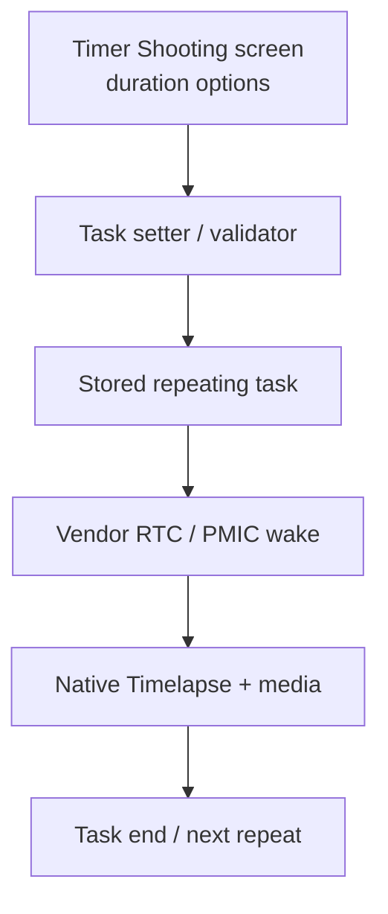

# Action 5 Pro — engineering target: 10h *inside* native Timer Shooting

**Status:** implementation design, **not a camera patch**. Target is **Action 5 Pro / AC204**, not Action 6. Historical Action 6 Mimo `02/6C` captures are only cross-model leads. See [two fully separate tracks](ACTION5_TWO_SEPARATE_TRACKS.md) and [Alliot root/ABI audit](ALLIOT_ACTION5_ROOT_ABI_AUDIT_2026-11-03.md).

## Target behavior and acceptance

- **Without any runtime phone, Bluetooth remote, ESP32, Pi, USB data connection or human button press**, the camera itself wakes at (e.g.) **08:00**, performs genuine native Timelapse at **1-second interval** for **10 hours**, stops at **18:00**, saves intact media, returns to its vendor-managed low-power/scheduled state, and repeats next day.
- Preserve DJI's temperature/storage/low-energy protections, time zone and power behavior; do not switch to normal video, run continuously overnight or fake an 8h/10h UI label.
- Separate the one-time development/installation connection from the operational requirement: temporary USB/ADB on a workbench may be needed to install an eventual native patch, but **nothing external may be necessary once deployed**.

## 1. Native path versus external control (do not mix)

| Layer | Native Track N (TARGET) | External Track B (FALLBACK) |
|---|---|---|
| Programming UI | DJI camera's Timer Shooting / Repeat; potentially a firmware-matched on-camera GUI extension | ESP32/Pi/phone scheduler UI |
| Programmed task | Internal stored start time, duration, mode and Repeat | Host time window |
| Shoot trigger | Internal DJI task/RTC/PMIC wake path | BLE/remote START |
| End trigger | Internal scheduled duration/time end | BLE/remote STOP |
| Protocol leads | Proprietary native GUI/service API and task persistence | R SDK `1D03`; separate ordinary Timelapse `02/6C` experiments |
| Critical blocker | Native task setter and 10h validator unknown | Moon-mode radio stop and long-overnight reconnect/wake |

The two tracks must have separate test reports, ownership, success criteria and code modules. A Bluetooth success **never closes** the native 10h acceptance requirement.

## 2. Internal ownership map to recover

The names above are **functional unknowns**, not symbols verified in DJI binaries. Explicit ownership evidence is required at every arrow.

### Distinct limits that could exist

1. **UI-only menu cap:** menu enumerates `5h` as largest finite choice, while a backend can accept a larger task; simplest possible, but not established.
2. **Setter/backend validation:** unknown native handler rejects or clamps anything above 5h; a cosmetic GUI change alone would fail.
3. **Persistence schema:** stored task may use a byte-sized enum or short duration table rather than seconds; 10h may require a second validation or encoding change.
4. **Schedule/wake constraint:** native scheduler/RTC alarm may interpret an *end wall-clock time* rather than elapsed seconds, may be daylight-saving sensitive or have a max window. No evidence yet.
5. **Runtime capture constraint:** 1 s image interval, SD free space, temperature and power may stop an otherwise accepted 10h task. Never interpret acceptance as recording endurance.

### Encoding candidates (hypotheses for offline search, NOT established Timer fields)

| Candidate representation | 5 h | 10 h | Meaning |
|---|---|---|---|
| Seconds `uint32` LE | `50 46 00 00` (18000) | `A0 8C 00 00` (36000) | Observed **ordinary** Action 6 Timelapse `02/6C`; Timer task unqualified |
| Minutes `uint32` LE | `2C 01 00 00` (300) | `58 02 00 00` (600) | Possible task schema, untested |
| Minutes `uint16` LE | `2C 01` | `58 02` | Possible compact task schema, high false-positive rate |
| Milliseconds `uint32` LE | `80 A8 12 01` (18,000,000) | `00 51 25 02` (36,000,000) | Possible internal timer API; untested |
| Enum / index | **Unknown** | **Unknown** | Must derive real mapping from multiple UI choices |

**Do not patch the first matching literal.** A byte sequence in an ELF is not a proven table, and LE32 values can be instructions, pointers, unrelated constants or ordinary Timelapse state. Use cross-references, controlled A/B behavior and task readback to establish causality.

## 3. Discovery sequence with proof gates

### N0 — Baseline on stock camera (no root)

Record model/firmware, language, time zone, Timer Shooting UI screenshots, schedule Repeat behavior, ordinary Timelapse 1 s/∞, moon low-power setting, battery/USB supply and SD size. Confirm the actual maximum offered by **Timer Shooting**, not simply the Timelapse selection list. Check whether the schedule can be set through Mimo or only the physical camera screen.

### N1 — Isolate the scheduled-task payload

Use controlled changes with one variable at a time: 3h→5h **Timer Shooting**, `08:00→09:00` start, Repeat off→on; separately, ordinary Timelapse ∞→5h. If Mimo can alter the task, use redacted Wi-Fi/HCI captures; if only the local screen changes, there may be **no Mimo SET packet at all**. In that case, prioritize authorized read-only native GUI/ELF inspection after root is safely established. Do not interpret missing network frames as missing internal API.

### N2 — Root, recovery and ELF map (separate explicit authorization)

Follow [Alliot audit gates](ALLIOT_ACTION5_ROOT_ABI_AUDIT_2026-11-03.md). The Alliot article and unlock archive must first be reviewed for the exact firmware. Require verified partition backups, compatible signed recovery access and a return-to-stock rehearsal. The current project **has not qualified** these, and will not run any EDL/flash command on the user's camera.

If and only if a compatible camera is already legitimately root-ADB enabled, use read-only preflight and owner-held copies of the specific GUI/task binaries. Preserve SHA and original file provenance; run the [offline scanner](../tools/scan_osmo_native.py). Use Ghidra/radare2 xrefs to discriminate (a) GUI capability table, (b) task-set message/struct, (c) daemon persistence and (d) wake owner.

### N3 — Try the least invasive accepted 10h operation

Only with model/ABI proof, explicit recovery plan and owner approval: evaluate a **reversible native task settings operation** with 36,000 s, keeping its original 3h or 5h known-good task in reserve. Require independent post-write readback from **Timer Shooting**, no silent clamping, camera UI coherence and persistence after reboot. Ordinary `cam_lapse_param` readback is insufficient.

### N4 — UI extension, then deeper firmware changes if necessary

- If backend accepts 10h and only menu is limited: implement a firmware-fingerprint-gated **native on-camera option** using the proven Alliot GUI wrapper technique, with a narrow allowlist and an independent rollback watchdog. Verify 10h from backend and MP4 before labeling it supported.
- If backend rejects 10h: establish the actual validator function(s), task storage and wake constraints before proposing an ELF patch. No guessed symbol/offset override; no broad firmware reflashing. A native companion daemon is a fallback only if scheduled wake can be preserved.
- Rebuilt proprietary binary, modified signed image, partition write or bootloader action is a new high-risk phase and requires separate sign-off. Do not deploy blind patches based on scraped symbol names.

### N5 — Full hardware qualification

1. 10h task survives camera power cycle; no Mimo/ESP32 connected.
2. 10h from native start, **actual footage past 5h**, media frame count and timestamps independently checked.
3. Correct scheduled stop with no overnight capture; no interruption of manual recording.
4. Correct internal wake next morning; repeated 2 days, then >=7-day endurance.
5. Battery/powerbank current vs interval, temperature, SD remaining, failure/power-loss recovery, daylight-saving transitions and weatherproof external power considered.
6. Native code and GUI modifications reversible on exact firmware; security of local root service reviewed.

## 4. Explicit non-evidence and current blocker

- Alliot's local recording **does not currently prove the Timelapse mode** or Timer Shooting task interface.
- `gui_autorecord_param` is only a **subscribed name**, with diving Auto Record as an alternative interpretation. It is **not** a decoded native schedule setter.
- A proposed `36,000` in a 32-bit field does **not** prove camera acceptance.
- The upstream GUI plugin proves a **possible in-camera user interface** but not a native 10h scheduling backend.
- The author's unlock ZIP exists but its contents have **not** been inspected in this environment. Do not infer a safe EDL unlock/recovery path from asset existence.

**Next blocking evidence:** exact Action 5 Pro firmware/build and the actual Timer Shooting menu state, followed by source-verified root/recovery compatibility and a 3h↔5h scheduled-task delta. This is the shortest credible path to a native 10h change.
